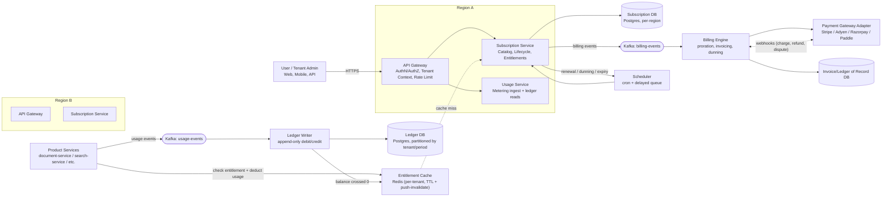
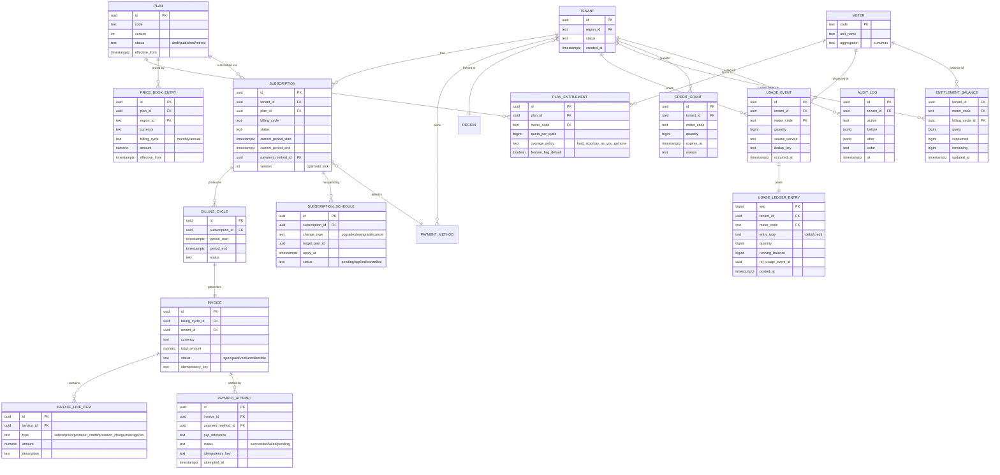
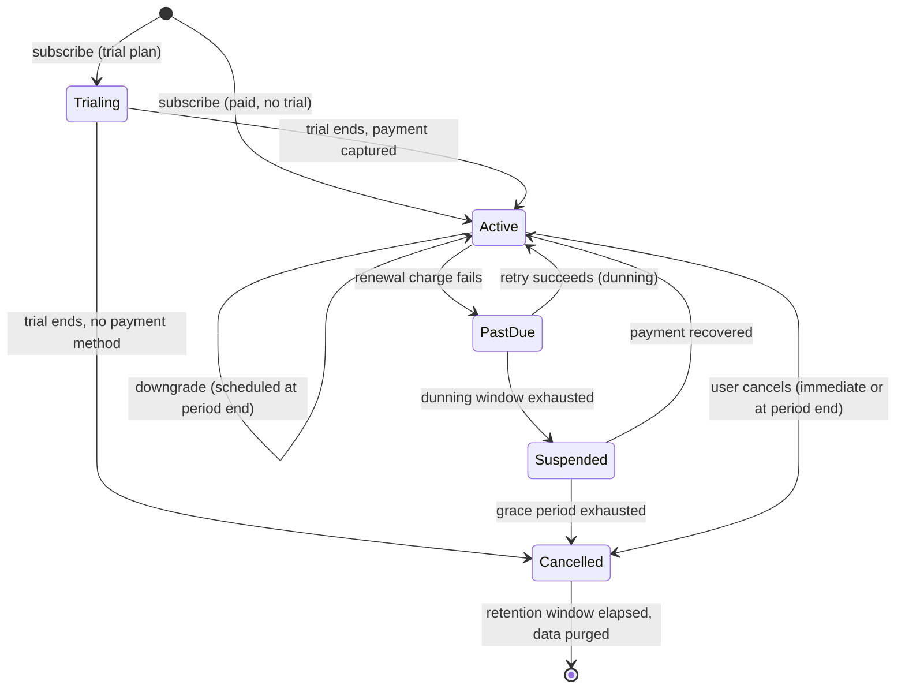
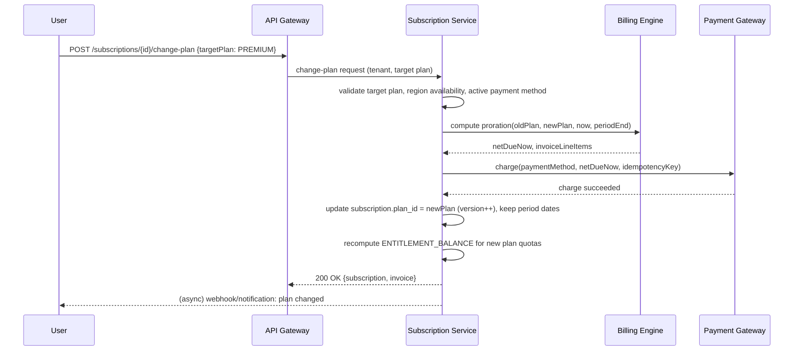
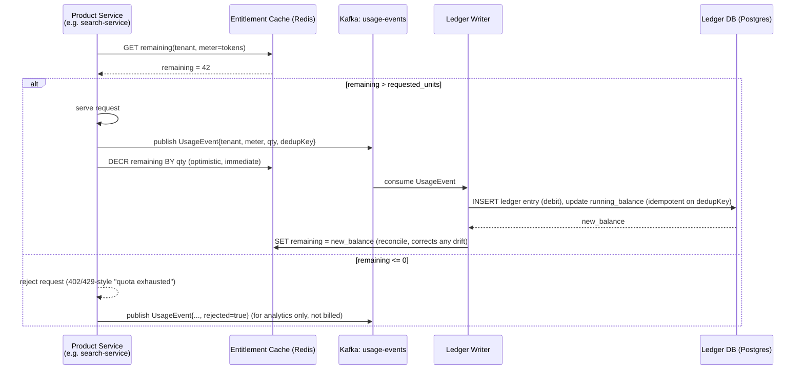

# Subscription System — Design Document

## Global, Multi-Tenant, Catalog-Based Subscription & Billing Platform

**Reference model:** a Claude-style subscription product — three public catalogs (**Basic**, **Pro**, **Premium**),
each with different entitlements, sold globally across regions/currencies, with self-serve upgrade/downgrade,
usage metering, and a token-ledger-style consumption model that cuts off service the moment a tenant exhausts what
its plan entitles it to.

This document specifies the workflow, the domain model, the schema, the API surface, the deployment topology, and the
billing/ledger mechanics for a `subscription-service` that would sit alongside `gateway`, `document-service`,
`indexer-service` and `search-service` in this platform.

---

## Table of Contents

1. [Goals & Non-Goals](#1-goals--non-goals)
2. [Subscription Catalog (Basic / Pro / Premium)](#2-subscription-catalog-basic--pro--premium)
3. [High-Level Architecture](#3-high-level-architecture)
4. [Domain Model / Entities](#4-domain-model--entities)
5. [Database Schema](#5-database-schema)
6. [Subscription Lifecycle State Machine](#6-subscription-lifecycle-state-machine)
7. [Upgrade / Downgrade & Proration Rules](#7-upgrade--downgrade--proration-rules)
8. [Release Conditions (Entitlement Gating)](#8-release-conditions-entitlement-gating)
9. [Usage Metering & the Consumption Ledger](#9-usage-metering--the-consumption-ledger)
10. [API Endpoints](#10-api-endpoints)
11. [Global / Multi-Region / Multi-Payment Architecture](#11-global--multi-region--multi-payment-architecture)
12. [Deployment Strategy](#12-deployment-strategy)
13. [Failure Handling, Dunning & Reconciliation](#13-failure-handling-dunning--reconciliation)
14. [Security, Compliance & Observability](#14-security-compliance--observability)
15. [Assumptions & Open Questions](#15-assumptions--open-questions)

---

## 1. Goals & Non-Goals

**Goals**

- Sell a small number of public **catalogs** (Basic/Pro/Premium) with clearly bounded entitlements, priced per
  region/currency.
- Let a tenant/user **upgrade or downgrade** self-serve at any time; the billing cycle and proration follow the same
  rules Stripe/Chargebee/Recurly use in production today, so this is not reinventing billing semantics.
- Meter consumption (messages, tokens, storage, seats — whatever the plan grants) against entitlements in near
  real time, the way Anthropic meters Claude usage, and **stop serving the tenant** the instant its ledger balance for
  a metered resource hits zero, without waiting for a batch job.
- Operate globally: multiple countries/regions, multiple currencies, multiple payment processors, tax rules, and
  data-residency constraints.
- Keep an **immutable, auditable ledger** of every entitlement grant and every unit consumed, per tenant, the same
  way a token ledger works — so billing disputes and support are answerable from data, not memory.

**Non-goals**

- This document does not implement a specific PSP (Stripe/Adyen/Razorpay) integration in code — it defines the
  abstraction boundary so any of them can be plugged in.
- It does not cover enterprise custom/negotiated contracts (only the three self-serve catalogs), though the model
  extends to that case via the same `plan` abstraction.

---

## 2. Subscription Catalog (Basic / Pro / Premium)

Catalogs are **versioned** so a price/entitlement change never mutates what an already-subscribed tenant agreed to;
existing subscribers stay pinned to the plan version they subscribed under until they change plans or the operator
explicitly migrates them (with notice).

| Feature (illustrative)         | Basic                  | Pro                          | Premium                        |
|---------------------------------|------------------------|-------------------------------|----------------------------------|
| Price (base currency, monthly)  | Free / low tier        | Mid tier                      | High tier                        |
| Billing cycles offered          | Monthly                | Monthly, Annual (discounted)  | Monthly, Annual (discounted)     |
| Metered unit quota / cycle      | e.g. 1,000,000 units    | e.g. 15,000,000 units          | e.g. 100,000,000 units + pooled  |
| Overage behavior                | Hard stop               | Hard stop or pay-as-you-go add-on | Pay-as-you-go add-on         |
| Concurrent seats                | 1                       | 5                              | Unlimited / org-wide             |
| Priority routing / SLA          | Best effort             | Standard SLA                  | Priority SLA + dedicated support |
| Data retention                  | 30 days                 | 1 year                         | Configurable / unlimited         |
| Feature flags unlocked          | `basic_search`          | `basic_search`, `advanced_filters` | all + `premium_analytics`   |
| Region availability             | Global                  | Global                         | Global (subject to export control) |

Each row above is not hard-coded — it lives in the catalog/entitlement tables (§5) so product can add a **Team** or
**Enterprise** catalog later without a schema change.

---

## 3. High-Level Architecture



Notes:

- **Entitlement checks are cache-first, ledger-authoritative.** Product services never call the subscription DB
  synchronously on the hot path; they check a Redis-resident entitlement snapshot (plan limits + remaining balance)
  and emit a usage event. The ledger writer is the only writer of truth; cache is invalidated/pushed on every
  material change (plan change, balance crossing zero, renewal).
- **Kafka decouples usage ingestion from the ledger write**, the same pattern already used for
  document → indexer in this repo, so the metering path can absorb bursts without blocking the calling service.
- Subscription/catalog data is **replicated read-only to every region**; the tenant's **billing record of truth**
  lives in its home region (data residency), with cross-region async replication for DR only.

---

## 4. Domain Model / Entities

| Entity | Responsibility |
|---|---|
| `Tenant` | Top-level billing owner (an org or an individual account). |
| `Region` | Legal/data-residency region a tenant is homed in (e.g. `us`, `eu`, `in`, `apac`). |
| `Currency` / `PriceBook` | ISO currency + region-specific price for each plan/cycle. |
| `Plan` (Catalog) | Basic/Pro/Premium — versioned, immutable once published. |
| `PlanEntitlement` | Row per (plan, feature/meter) → quota, overage policy, feature flag. |
| `Subscription` | A tenant's active/historical binding to a `Plan` version + billing cycle. |
| `SubscriptionSchedule` | Pending change (upgrade/downgrade/cancel) scheduled to apply at a future time. |
| `BillingCycle` | One period instance of a subscription (start/end, invoice, proration lines). |
| `Invoice` / `InvoiceLineItem` | Amount owed for a cycle, incl. proration and overage lines. |
| `PaymentMethod` | Tokenized reference to a card/wallet held by the PSP (never raw PAN). |
| `PaymentAttempt` | One charge attempt against a `PaymentMethod`, with PSP response/idempotency key. |
| `Meter` | A countable resource type (e.g. `tokens`, `searches`, `storage_gb`). |
| `UsageEvent` | Raw, immutable "N units of meter X consumed at time T" fact (Kafka + append log). |
| `UsageLedgerEntry` | Debit/credit posting derived from `UsageEvent`, append-only, drives the running balance. |
| `EntitlementBalance` | Materialized "remaining balance per tenant per meter per cycle" (cache + snapshot table). |
| `Coupon` / `CreditGrant` | Promo or goodwill credit applied as a ledger credit, with expiry. |
| `WebhookEvent` | Inbound PSP event, stored for idempotent replay/reconciliation. |
| `AuditLog` | Every entitlement/plan/payment state transition, who/what/when. |

---

## 5. Database Schema



Design notes:

- `USAGE_LEDGER_ENTRY` is **append-only** (no updates/deletes) and partitioned by `(tenant_id, month)` — this is
  the "token ledger" analog: every debit is a row, `running_balance` is a materialized rolling value so reads are
  O(1) without re-summing history, and the log itself is the audit trail.
- `ENTITLEMENT_BALANCE` is a **read-optimized projection** rebuildable from `USAGE_LEDGER_ENTRY` + `PLAN_ENTITLEMENT`
  + `CREDIT_GRANT`; it is what the Redis cache in §3 mirrors. Losing the cache never loses truth.
- `SUBSCRIPTION.version` is an optimistic-concurrency column — plan changes and renewals are compare-and-swap
  updates to avoid double-applying a scheduled downgrade if the scheduler fires twice.
- All monetary columns are `numeric`, never float; currency is always stored alongside amount.

---

## 6. Subscription Lifecycle State Machine



- **Active** is the only state in which product services grant full entitlement per the plan; every other state
  maps to a reduced or zero entitlement (see §8).
- Every transition is written to `AUDIT_LOG` and emits a `billing-events` Kafka message so downstream services
  (entitlement cache, notifications, analytics) react without polling.

---

## 7. Upgrade / Downgrade & Proration Rules

These follow the same convention as Stripe/Chargebee, so support and finance already understand them:

| Change | When it takes effect | Proration |
|---|---|---|
| **Upgrade** (Basic→Pro, Pro→Premium) | **Immediately** | Tenant is credited the unused portion of the current cycle on the old plan and charged the prorated cost of the new plan for the remainder of the cycle. The billing anchor date does not move. |
| **Downgrade** (Premium→Pro, Pro→Basic) | **At the end of the current billing cycle** (default) — or immediately with a prorated refund credit, if the product explicitly enables "downgrade now" | No mid-cycle charge for the default path; if immediate downgrade is enabled, remaining balance of the old plan is refunded/credited and the new plan's lower quota applies right away (usage already consumed this cycle is **not** un-consumed). |
| **Cycle/billing-period change** (monthly→annual) | At next renewal, or immediately with proration if the tenant opts in | Same proration math as upgrade, applied to the price delta between the two cycle lengths. |
| **Plan-version migration** (operator changes catalog pricing) | At the tenant's next renewal, never mid-cycle, with advance notice | No proration; existing cycle honors the price/entitlement version the tenant subscribed under. |

Proration formula (standard time-based proration):

```
remaining_days = period_end - now
proration_credit = old_plan_price * (remaining_days / cycle_length_days)
proration_charge = new_plan_price * (remaining_days / cycle_length_days)
net_due_now      = proration_charge - proration_credit   // can be negative → refund/credit
```

Upgrade sequence:



If the charge fails, the plan change is **not applied** — the subscription stays on the old plan and the
API returns the payment failure so the client can prompt for a different payment method.

---

## 8. Release Conditions (Entitlement Gating)

"Release condition" = the condition(s) that must hold before a tenant is granted (or keeps) the entitlements of a
plan. Every one of these is evaluated by the Subscription Service, not left implicit:

1. **Payment captured** — for paid plans, the first invoice (or trial-conversion invoice) must reach `paid` before
   `Active` entitlements are released; otherwise the tenant sits in `Trialing`/`PastDue` with base/no entitlements.
2. **Region & export-control compliance** — the tenant's `region_id` must be in the plan's allowed region list
   (sanctions/export-control lists checked at subscribe time and periodically re-checked).
3. **KYC/fraud check pass** — above a configurable spend threshold, a fraud/velocity check must pass before
   Premium entitlements release (chargeback risk mitigation).
4. **Previous invoice settled** — a tenant with any `open`/`uncollectible` invoice past its due date cannot
   upgrade (must resolve or downgrade path only) — prevents debt accumulation across plan changes.
5. **Usage cap not exceeded at time of downgrade** — if a scheduled downgrade would put current-cycle consumption
   over the new plan's quota, the downgrade still applies at cycle boundary (quota resets), but the UI/API warns
   the tenant beforehand.
6. **ToS / contract version acceptance** — plan activation requires the tenant has accepted the ToS version tied
   to that plan/region (e.g., data-processing addendum required for enterprise-grade Premium features in the EU).
7. **Feature rollout gating** — a plan entitlement can carry a `feature_flag_default` that is additionally gated by
   a global rollout percentage/allowlist (staged rollout of a new Premium feature independent of billing).
8. **Cooldown period** — downgrade → upgrade → downgrade thrash is rate-limited (e.g., one plan change per N hours)
   to prevent proration abuse.
9. **Payment method on file & not expiring within cycle** — renewal is blocked pre-emptively (dunning pre-check)
   if the card expires before the next renewal date, with a notification asking the tenant to update it.

All nine are implemented as independent, composable predicate functions (`ReleaseCondition` interface) evaluated in
order at: subscribe time, plan-change time, and renewal time. The first failing condition determines the resulting
state (`PastDue`, `Suspended`, or a rejected request with a specific error code) — this makes the gating logic
testable in isolation and auditable per tenant.

---

## 9. Usage Metering & the Consumption Ledger

This is the "token ledger" mechanic, generalized to any metered resource.



Key properties:

- **Optimistic local decrement + async authoritative reconciliation.** The cache is decremented synchronously so
  concurrent requests can't race past zero (Redis `DECRBY` is atomic), while the Postgres ledger is the durable,
  reconciled source of truth a few hundred ms later. This mirrors how token-metered LLM APIs gate a request against
  a remaining-budget check before executing it, then post the actual debit once known.
- **Idempotent by `dedup_key`.** Every `UsageEvent` carries a dedup key (e.g. request ID); the ledger writer
  upserts on conflict so Kafka redelivery never double-charges.
- **Hard cutoff is immediate, not batch.** The moment `ENTITLEMENT_BALANCE.remaining` reaches 0 for a hard-stop
  meter, the next request at the gateway/product-service layer is rejected before doing any billable work — there
  is no "we'll reconcile tomorrow and claw back."
- **Overage (pay-as-you-go) meters** don't reject at zero; they keep debiting into negative `remaining` and an
  `overage` line item accumulates on the draft invoice for the current cycle, billed at cycle close.
- **Renewal resets the ledger balance**, not by deleting history — a new `ENTITLEMENT_BALANCE` row is created per
  `billing_cycle_id`; old cycles' entries remain queryable forever for support/audit ("why was I cut off on the
  14th").
- **Credits/coupons** post as `credit` entries against the same ledger, consumed before plan quota (configurable
  order), so a promo credit and a plan quota are indistinguishable to the deduction logic — just two credit
  sources feeding one balance.

---

## 10. API Endpoints

All endpoints sit behind the existing API Gateway (tenant context + auth already enforced there per
`docs/architecture.md`). Subscription-service-owned paths:

**Catalog (public, cached, region-aware)**

- `GET /v1/catalog/plans?region={region}` — list Basic/Pro/Premium with region price + entitlements.
- `GET /v1/catalog/plans/{planCode}` — plan detail (specific version currently published in the caller's region).

**Subscription lifecycle (tenant-scoped)**

- `POST /v1/subscriptions` — subscribe to a plan (`planCode`, `billingCycle`, `paymentMethodId`).
- `GET /v1/subscriptions/{id}` — current subscription, status, period dates, pending schedule.
- `POST /v1/subscriptions/{id}/change-plan` — upgrade/downgrade (`targetPlanCode`, `effective: immediate|period_end`).
- `POST /v1/subscriptions/{id}/cancel` — cancel (`effective: immediate|period_end`).
- `POST /v1/subscriptions/{id}/reactivate` — undo a pending cancellation before it applies.
- `POST /v1/subscriptions/{id}/payment-methods` — attach/replace payment method (tokenized PSP reference only).

**Usage & entitlements (tenant-scoped, high volume — read path is cache-backed)**

- `GET /v1/usage/{meterCode}/balance` — current remaining balance for the active cycle.
- `GET /v1/usage/{meterCode}/history?cycle={id}` — ledger entries for a cycle (support/audit UI).
- `POST /internal/usage/events` — internal ingest endpoint used by product services (also available via Kafka
  directly for the async path; HTTP path exists for services without a Kafka producer).

**Billing**

- `GET /v1/invoices` / `GET /v1/invoices/{id}` — invoice list/detail.
- `POST /v1/invoices/{id}/retry-payment` — manual retry during dunning.

**Webhooks (inbound, PSP → us)**

- `POST /webhooks/payments/{provider}` — signature-verified PSP callback (charge succeeded/failed, dispute,
  refund); idempotent on PSP event ID via `WebhookEvent` dedup table.

**Admin (internal, catalog/ops)**

- `POST /admin/v1/plans` / `PATCH /admin/v1/plans/{id}/publish` — create/publish a new plan version.
- `POST /admin/v1/tenants/{id}/credit-grants` — issue a promo/goodwill credit.
- `POST /admin/v1/tenants/{id}/suspend` / `/reinstate` — manual override, always audit-logged.

---

## 11. Global / Multi-Region / Multi-Payment Architecture

- **Region-homed billing record of truth**, globally readable catalog. A tenant is assigned a home `region_id` at
  signup (based on billing address/data-residency requirement); its `Subscription`/`Invoice`/ledger rows live in
  that region's database. Catalog and price-book data is published to all regions read-only.
- **Payment Gateway Adapter layer** — a `PaymentGatewayPort` interface (`charge`, `refund`, `tokenizeMethod`,
  `verifyWebhookSignature`) with one adapter per PSP. Region → preferred PSP mapping lets the platform use, e.g.,
  Stripe/Adyen for US/EU and a local PSP (Razorpay, Paddle-as-merchant-of-record) where required for tax/regulatory
  reasons, without changing the domain model.
- **Currency & tax**: `PRICE_BOOK_ENTRY` gives the base price per region/currency; a tax engine (Avalara/PSP-native
  tax, or a merchant-of-record PSP that assumes tax liability) computes the tax line item per invoice based on
  tenant billing address — kept as its own pluggable step so tax-rule changes never touch core billing logic.
- **Merchant of record option**: for regions with complex VAT/GST obligations, routing through a
  merchant-of-record PSP (e.g. Paddle) offloads tax liability entirely — a per-region config flag, not a code
  branch.
- **Idempotency everywhere money moves**: every charge/refund call carries an idempotency key derived from
  `(invoice_id, attempt_number)`; PSP webhooks are deduplicated by PSP event ID before they're allowed to mutate
  invoice/subscription state.
- **Clock/timezone discipline**: all cycle boundaries are stored and computed in UTC; only presentation converts to
  the tenant's local timezone, to keep proration math unambiguous across regions.

---

## 12. Deployment Strategy

Following the pattern already used for `search-service`'s blue-green setup, extended for global scale:

- **Topology**: `subscription-service` and `usage-service` deployed **active-active per region** behind a global
  load balancer/anycast entry, with the API Gateway routing to the nearest healthy region. Each region runs its own
  Postgres (billing record of truth, one per region, streaming replica in a secondary region for DR) and its own
  Kafka cluster for `usage-events`/`billing-events`.
- **Catalog replication**: plan/price-book changes are published in the "home" admin region and replicated to all
  regions via a low-frequency (seconds-level) async replication job or CDC (Debezium-style), consistent with this
  repo's existing PostgreSQL→Kafka→Elasticsearch pattern for `document-service`→`indexer-service`.
- **Rollout of a new plan/catalog version**: blue-green at the *data* level, not the deploy level — a new `Plan`
  row with `status = draft` is fully populated and validated before flipping to `published`; existing subscriptions
  are never migrated automatically (§7, plan-version migration only at renewal).
- **Ledger writer scaling**: partitioned Kafka topic (`usage-events`, partitioned by `tenant_id`) with a consumer
  group of ledger writers — horizontal scaling identical to the `indexer-service` consumer-group model already in
  this repo; partition key on `tenant_id` guarantees per-tenant ordering so balance updates never race for the same
  tenant.
- **Entitlement cache**: Redis cluster per region (already used for gateway rate limiting) with a dedicated
  keyspace/DB index for entitlement balances; replicated within-region only (cache, not source of truth — a region
  failover simply rebuilds it from Postgres).
- **Blue-green for the billing engine binary itself** mirrors `search-service`'s existing nginx-fronted blue-green
  (`docs/architecture.md` §6) — safe to reuse verbatim, since billing-engine rollouts are the highest-risk deploys
  in this system and deserve the same zero-downtime switch mechanism.
- **Disaster recovery**: cross-region async replica of each region's billing DB; RPO measured in seconds via WAL
  shipping/logical replication; failover runbook promotes the replica and repoints the region's Kafka producers —
  ledger's append-only, idempotent-by-dedup-key design means replaying the last few minutes of `usage-events` after
  failover is safe (no double-charging).
- **Schema migrations**: expand/contract pattern (add nullable column → backfill → enforce → drop old), applied
  per region independently, never a blocking global migration — consistent with running N regions on
  slightly different rollout timing without breaking cross-region catalog replication.

---

## 13. Failure Handling, Dunning & Reconciliation

- **Dunning schedule on renewal failure**: retry at, e.g., +1 day, +3 days, +7 days (configurable per region/PSP
  norms); subscription moves `Active → PastDue` on first failure, entitlements reduced to a minimal/read-only tier
  immediately (not "full access until dunning exhausts" — that's a revenue leak), then `PastDue → Suspended` if all
  retries fail, then `Suspended → Cancelled` after a grace period (e.g., 14–30 days) with data retained per
  retention policy before purge.
- **Webhook reconciliation job**: a periodic job diffs PSP-reported charge state against local `PaymentAttempt`
  rows to catch any missed webhook (network partition, PSP outage) — belt-and-suspenders on top of the real-time
  webhook path.
- **Ledger drift reconciliation**: a scheduled job recomputes `ENTITLEMENT_BALANCE` from `USAGE_LEDGER_ENTRY` +
  entitlements + credits and compares against the cached/materialized value; mismatches are logged and
  auto-corrected, feeding an alert if drift exceeds a threshold (signals a bug, not something to silently paper
  over).
- **Chargebacks/disputes**: a dispute webhook immediately flags the tenant (`AUDIT_LOG` + optional auto-suspend
  above a risk threshold) rather than waiting for the next renewal cycle.

---

## 14. Security, Compliance & Observability

- **PCI-DSS scope minimization**: raw card data never touches this system — only PSP-issued tokens
  (`PaymentMethod.psp_reference`) are stored, keeping `subscription-service` out of full PCI scope (SAQ-A level).
- **Data residency / GDPR**: tenant billing data stored in its home region; right-to-erasure implemented as
  anonymization of `Tenant`/`Invoice` PII fields while preserving the financial ledger rows required for tax/audit
  retention (legally required even after account deletion, typically 7 years).
- **AuthZ**: plan-change and payment-method endpoints require step-up auth (re-auth or MFA) beyond the base
  session, given the financial blast radius.
- **Audit trail**: every state transition in §6 and every entitlement/plan/payment mutation writes to
  `AUDIT_LOG`, immutable, queryable per tenant — this is the system's answer to "why was I charged/cut off."
- **Observability**: following the correlation-ID/metrics conventions already established elsewhere
  in this repo — subscription/renewal/dunning transitions, ledger balance, and PSP webhook latency are first-class
  metrics/traces, not just HTTP request metrics.
- **Alerting**: entitlement-cache/ledger divergence, webhook processing lag, and dunning-queue depth are paged
  metrics — these directly predict revenue leakage or wrongful service cutoff if they drift.

---

## 15. Assumptions & Open Questions

- Assumes three self-serve catalogs only; enterprise/negotiated contracts would reuse the same `Plan`/`Subscription`
  model with a `custom` plan type and a sales-assisted subscribe flow, not a schema change.
- The specific list of supported regions (e.g. `["us","eu","in","apac"]`) is a product decision, not an
  architectural one, and is left out of this document on purpose.
- Assumes overage billing (pay-as-you-go beyond quota) is enabled for Pro/Premium but not Basic — configurable per
  plan entitlement (`overage_policy`), so this is a launch-config decision rather than a code decision.
- Merchant-of-record vs. direct-PSP-per-region is left as a per-region deployment configuration; both are supported
  by the same `PaymentGatewayPort` abstraction, so it can be decided market-by-market without re-architecting.
